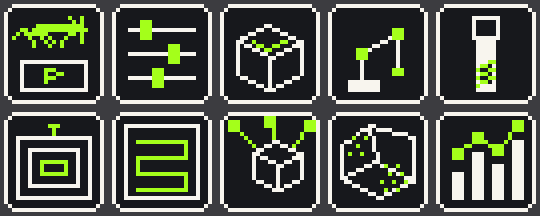

# CamGh

A Rhino 8 / Grasshopper CAM plug-in for **subtractive milling**, built for 3-axis CNC and 6-axis robot milling of sculptural parts. Heavy computation runs in a separate local engine process, so Grasshopper stays responsive, and the engine also serves a 3D simulation dashboard.

> Research prototype: generated paths are candidates for simulation and review, not machine-ready code.

## Features

- **Roughing**: Z-level and surface-offset strategies, 3-axis (Horizontal Roughing) and multi-axis 3+2 with automatic tool-direction selection.
- **Finishing**: parallel raster and region finishing (patch segmentation with smooth borders, drop-cutter lanes), with stay-down links between passes.
- **Shared 3D stock** (tri-dexel) that every operation cuts, so undercuts, holes and removed volume are tracked.
- **Dashboard** with per-operation tables and a WebGL simulation (tool playback, stock after any operation).
- **Separate engine**: a local .NET 8 worker bound to loopback (`127.0.0.1:47831`).

| | |
|---|---|
|  **Dashboard overview**: per-operation tool, paths, cut length, removed volume. |  **Simulation**: 3+2 roughing paths, remaining stock and the tool moving on its own axis. |
|  **Region finishing** playback. |  **Patch segmentation** of the part into reachable regions. |
|  **Border smoothing** (curvature flow) gives smooth seams. |  **RhinoCAM reference vs CamGh** at one Z level (Z-level and surface-offset strategies). |
|  Horizontal roughing before and after the rewrite. |  Z-level offset rings before/after jiggle removal. |

## Requirements

- **Rhino 8** for Windows at `C:\Program Files\Rhino 8` (edit the four `HintPath` entries in `src/CamGh.Grasshopper/CamGh.Grasshopper.csproj` if yours lives elsewhere).
- **.NET 8 SDK**, or Visual Studio 2022 17.8+ with the .NET desktop workload.
- Windows x64. The engine is published self-contained, so end users need only Rhino 8.

## Quick start

```
git clone https://github.com/pitsieben/CAM-Hopper.git
cd CAM-Hopper
dotnet publish src/CamGh.Engine -p:PublishProfile=CamGhPackage
Install-CamGh.bat
```

Close Rhino first, because Grasshopper locks a loaded `.gha`. Then open one of the definitions in [`examples/grasshopper`](examples/grasshopper) with the matching mesh from [`examples/geometry`](examples/geometry). See [Build](#build) for Visual Studio steps.

## Repository layout

```
CamGh.sln
Install-CamGh.bat        copies publish/package into Grasshopper's Libraries folder
src/
  CamGh.Core/            toolpath algorithms, stock model, job planning (no Rhino dependency)
  CamGh.Engine/          local HTTP worker and dashboard (wwwroot/index.html)
  CamGh.Grasshopper/     Rhino 8 components and icons
tests/                   headless regression test (dotnet run -c Release --project tests)
examples/
  grasshopper/           sample .gh definitions
  geometry/              sample meshes (.stl, .3dm)
docs/
  algorithms.md          how the planners work, limits, next steps
  IMPLEMENTATION_LOG.md  dated build history
  references.md          papers and related tools
  images/                screenshots and icons
```

## Grasshopper components



Icons, first row: CAM Core, Cut Parameters, Stock, Machine Setup, Tool. Second row: Horizontal Roughing, Parallel Finishing, Multi-Axis Roughing, Region Finishing, CAM Analysis. The 50x50 PNG sources are in `docs/images/icons`.

| Component | Inputs | Outputs |
|---|---|---|
| **Tool** | Diameter, shape (`Flat` / `Ball`), flute count (default 2), RPM | Tool metadata, cutting speed, summary |
| **Cut Parameters** | Stepover %, stepdown %, pattern index (number slider), engage/retract type, clearance mode/value, stock-to-leave | Cut Parameters object, summary |
| **Stock** | Axis-aligned stock box | Stock object, bounds summary |
| **Machine Setup** | Name, units, safe start Z | Machine Setup object |
| **Horizontal Roughing** | Target mesh, Tool, Cut Parameters, optional grid resolution | Typed roughing command, summary |
| **Parallel Finishing** | Target mesh, Tool, Cut Parameters, direction, edge inset | Typed finishing command, summary |
| **Multi-Axis Roughing** | Part mesh, Tool, Cut Parameters, optional directions, max orientations, tool reach, fixture Z, grid and stock resolution | Typed 3+2 roughing command, summary |
| **Region Finishing** | Part mesh, Tool, Cut Parameters, optional directions, max orientations, max wall angle, sample step, overlap rings, border smoothing, position weight | Typed 3+2 finishing command, summary |
| **CAM Core** | List of commands, Stock, optional Machine Setup | Combined toolpath points (one branch per path), per-operation results, summary/clearance, engine state, tool axis per branch, robot target planes, remaining-stock preview, finishing patches, tilt map |
| **CAM Analysis** | Operation Results from CAM Core | Per-operation report, spindle RPM, cutting speed, per-path Z level, path points and contour/path curves grouped by operation and path |

Connect one or several operation commands to CAM Core's `Commands` input. Grasshopper preserves the list order, and CAM Core returns the operation paths in that order. For Cut Parameters Pattern Index, use integer slider values: `0 Offset`, `1 Offset Spiral`, `2 Linear`, `3 Spiral`, `4 Radial`, `5 High Speed`. Geometry belongs on operation components; CAM Core receives only commands and job-level stock/machine data. Connect CAM Core's `Operation Results` to CAM Analysis; the reported cutting speed is peripheral tool speed from diameter and RPM. Feed rate is not yet represented in the CAM command model.

Horizontal roughing uses triangle-mesh/Z-plane section contours for flat-tool Offset. Open slices are closed to the cutter-safe interior boundary of the base stock; if that route cannot be formed, a direct closure keeps the offset input closed. These stock-relative closures allow the outer region to participate in vector offsets. The contour is fitted with a tolerance-bounded cubic spline, then shrunk as robust vector polygon offsets with round joins and self-intersection cleanup. The stock height field remains for cut selection, in-process stock updates, and clearance checks. This is a contour-first offset implementation; it does not yet build the full segment-site Voronoi diagram and monotone-area spiral graph from Lambregts et al. Offset Spiral, Spiral, Linear, Radial, and High Speed still use raster-generated paths; High Speed is a geometric prototype, not a load-adaptive HSM solver. Parallel Finishing remains a straight parallel raster, and its Pattern input is not applied to that operation.

CAM Core's Toolpath output now includes clearance-plane links between cut segments and retracts after each segment. Ramp retract retraces the final cutting segment while rising; Vertical lifts at the endpoint. StayDown conservatively falls back to the clearance plane because the current static stock model cannot prove an in-cut link is collision-free. Manual clearance must be above the stock top. These curves still do not distinguish feed from rapid motion, and the Engage setting, controller-specific feeds, and NC post-processing are not implemented. Treat all generated paths as candidates for simulation and review, not machine-ready code.

## Dashboard

CAM Core starts the engine when it is placed (message under the component: *Engine autostarted. Awaiting data.*) and has a **Settings** button. The button opens a window with the engine dashboard. The dashboard is also served at <http://127.0.0.1:47831/>, so it can be opened in any browser while Rhino runs.

- **Overview**: four cards (Operations, Issues, Uptime, Version). Below them, a table per operation with the tool, directions/patches, paths and points, cut length, the volume each operation removed and its share of the block. There is also the server panel and recent activity.
- **Simulation**: a 3D view (drag to orbit, right-drag or shift-drag to pan, wheel to zoom, double-click to fit).
  - It shows the part, the stock box, each operation's toolpaths in its own colour (toggle each one), and links and rapids.
  - The remaining stock is a translucent surface. You can show it before machining or after any operation.
  - The tool model plays along the linked motions on its own axis (play/pause, speed, scrub). With *Stock follows simulation* on, the stock shown is the one the running operation is cutting.
  - The side panel draws the selected operation's cutter to scale, with diameter, shape, flutes, reach, rpm and cutting speed. It also has a bar per operation for the material removed.

The engine keeps the last job in memory. It shares the job with the window over `/api/v1/status`, `/api/v1/scene` and compact binary blobs (`/api/v1/scene/part`, `/stock/{i}`, `/paths/{op}`, `/motions`). Stock surfaces come from the tri-dexel model (surface nets on the exact ray crossings). They are watertight and match the dexel volume to within 0.2 %. Finishing operations are now subtracted from the shared stock as well, with the ball swept along each lane's axis. As a result, roughing and finishing removal are both visible.

The page lives in `src/CamGh.Engine/wwwroot/index.html` and has no external dependencies (WebGL2 viewer written in-file). `dotnet publish` copies it next to the engine. If the embedded web view is unavailable, the window falls back to the system browser.

## What changed since the first prototype

1. **Prototype**: parallel raster finishing and a height-field horizontal roughing, running in a separate local engine process (loopback HTTP/JSON) with Grasshopper components.
2. **Shared 3D stock**: a tri-dexel model (rays along X, Y, Z) replaced the height field for stock tracking, so undercuts and holes work. Every roughing and finishing operation is subtracted from it.
3. **3+2 operations**: Multi-Axis Roughing (automatic or given tool directions) and Region Finishing (patch segmentation, curvature-flow border smoothing, drop-cutter lanes).
4. **Engine dashboard**: embedded Settings window with overview tables and a WebGL simulation (tool playback, per-operation layers, stock after any operation). Falls back to Edge app mode or the default browser if the embedded view is unavailable.
5. **Roughing strategies**: `ZLevel` (levels exactly one stepdown apart, confirmed against a RhinoCAM 3-axis reference) and `SurfaceOffset`. Horizontal Roughing now runs through the multi-axis planner with a single vertical direction.
6. **Cleaner toolpaths**: Z-level offset rings are smoothed (Gaussian contour smoothing with a deviation bound, smoothed distance field and mask) to remove jiggle and artefacts.
7. **Stay-down linking**: Parallel and Region finishing connect neighbouring passes along the surface (drop-cutter in the tool frame) and only retract when no safe link exists. Pass ordering uses a spatial grid instead of an O(n²) search.
8. **Playback fix**: the play button now advances the timeline by path length and shows the exact removed material as a trail.
9. **Speed**: cut removal runs in parallel with striped locks, rays that cannot touch the cutter are skipped, the tool body is clamped to the stock extent, and finishing paths are simplified before cutting. On a 2-core machine, Region finishing on the sculpture went from about 63 s to about 44 s, Parallel finishing from about 43 s to about 30 s and surface-offset roughing from 16-19 s to about 13 s. Setting `CAMGH_PROFILE=1` prints a timing breakdown. The remaining cost is the number of ray tests per tool move (a stock-height-aware test is the next step).

Full details are in [docs/IMPLEMENTATION_LOG.md](docs/IMPLEMENTATION_LOG.md).

## Build

### Visual Studio (one click)

1. Close Rhino, and end any `CamGh.Engine.exe` that is still running in Task Manager.
2. Open `CamGh.sln`. In Solution Explorer, right-click **CamGh.Engine → Publish…**, choose the **CamGhPackage** profile and click **Publish**.
   - The profile is saved in `src/CamGh.Engine/Properties/PublishProfiles/CamGhPackage.pubxml`: Release, self-contained win-x64, into `publish/engine`.
   - When publishing finishes, the `CamGhPackage` target in `CamGh.Engine.csproj` builds `CamGh.Grasshopper` and fills `publish/package`. It copies in the engine, its `wwwroot` dashboard, `CamGh.gha` (renamed from `CamGh.Grasshopper.dll`) and the System.Drawing support DLLs.
   - The Output window ends with `CamGh: package ready in …`.
3. Run `Install-CamGh.bat`. It copies `publish/package` to `%APPDATA%\Grasshopper\Libraries\CamGh`. Then restart Rhino.

The same step from a terminal: `dotnet publish src/CamGh.Engine -p:PublishProfile=CamGhPackage`, then `Install-CamGh.bat`.

### Other

A headless regression test for the 3D stock, 3+2 roughing and region finishing is in `tests/Program.cs`. Run it with `dotnet run -c Release --project tests`. It prints PASS or FAIL for each check and exits with a non-zero code if any check fails.

The Grasshopper project references the RhinoCommon, Grasshopper and GH_IO assemblies of a local Rhino 8 install at `C:\Program Files\Rhino 8`. The engine stays available if CAM Core is removed from a definition, and is shut down when Rhino exits. It is assigned to a Windows job with kill-on-close and also has a process-exit cleanup fallback.

## Working with Claude

See [CLAUDE.md](CLAUDE.md) and [.claude/agents](.claude/agents) for the project notes and the multi-agent setup.

## Further reading

- [Algorithms and limits](docs/algorithms.md)
- [Implementation log](docs/IMPLEMENTATION_LOG.md)
- [References](docs/references.md)
- [Third-party notices](THIRD-PARTY-NOTICES.md) · Licence: [MIT](LICENSE)
