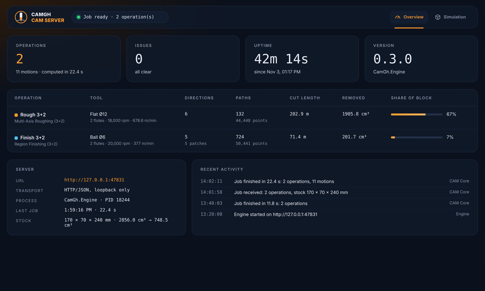
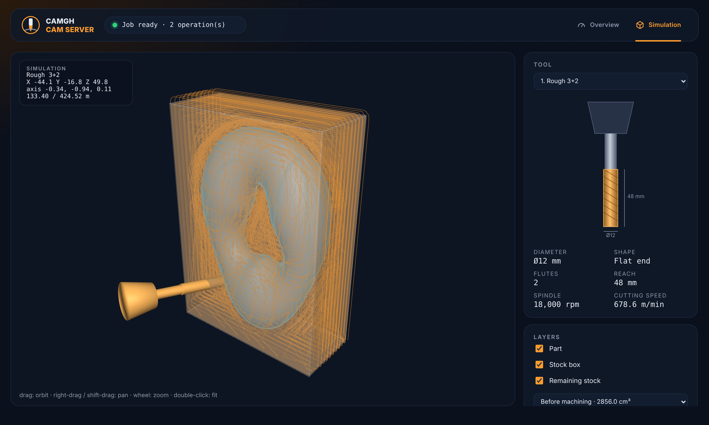
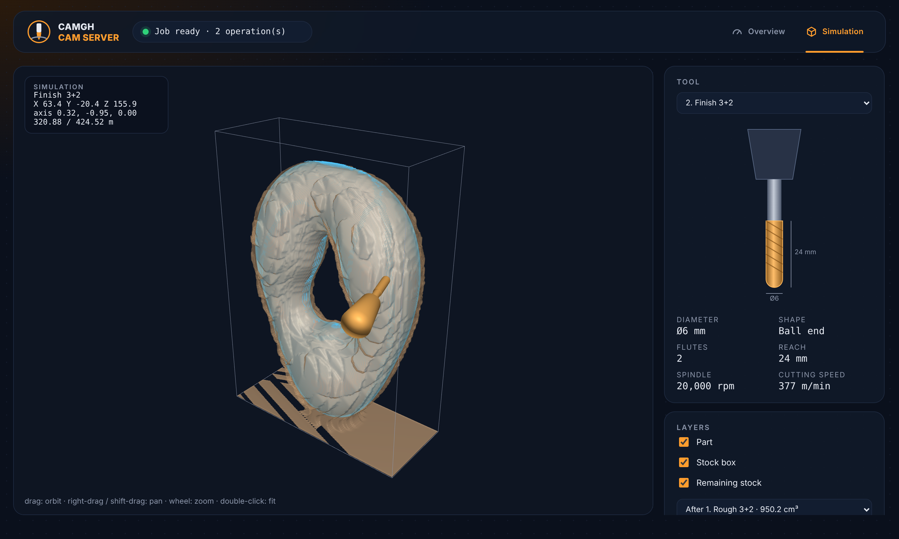
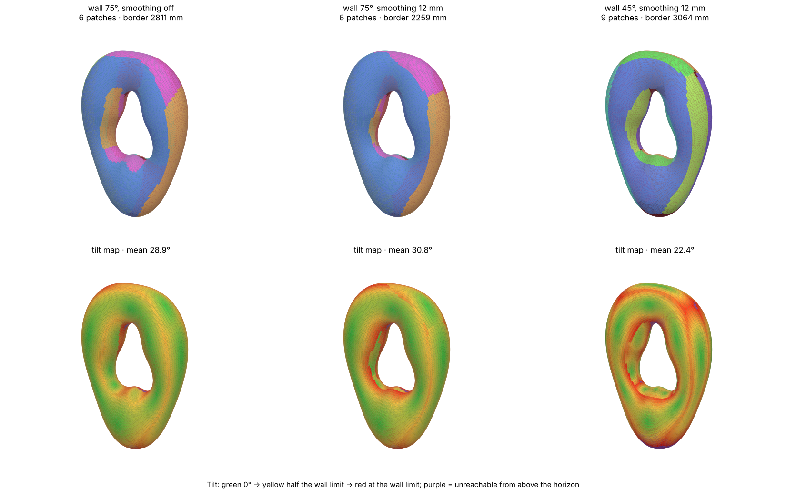
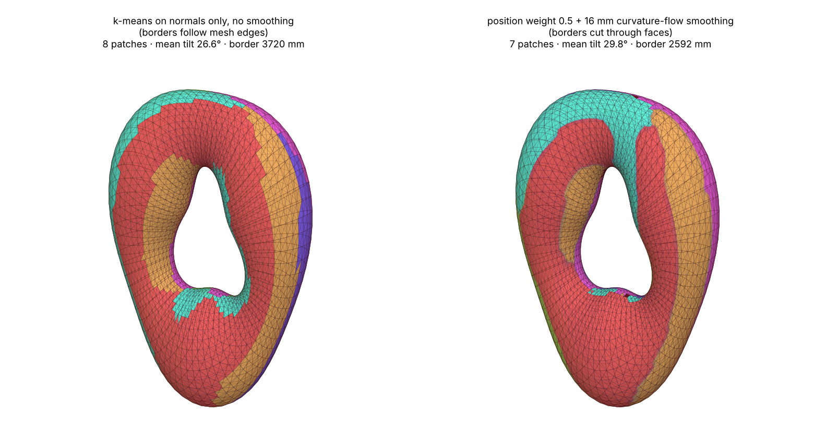
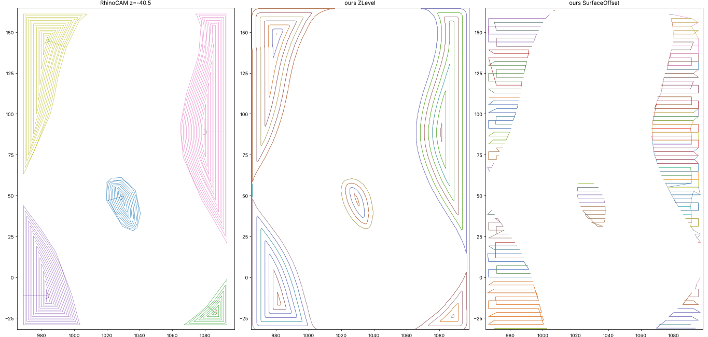
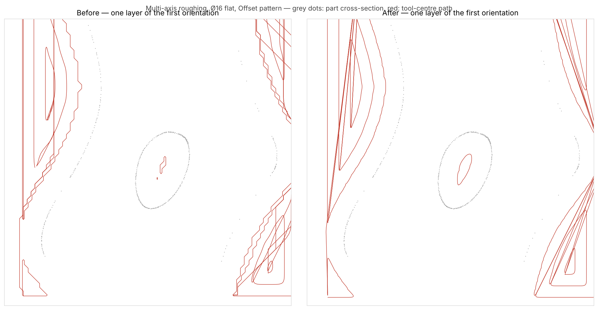
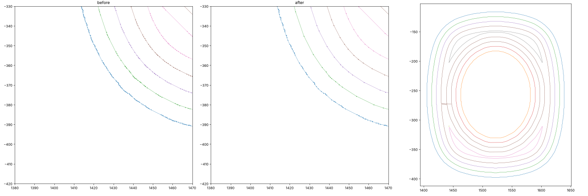

# CamGh prototype

This is a first vertical slice for a Rhino 8 / Grasshopper CAM plugin with a separate local computation process. It is a research prototype, not a machine-ready CAM system.

## Requirements

- **Rhino 8** for Windows, installed at `C:\Program Files\Rhino 8`. The Grasshopper project
  references `RhinoCommon.dll`, `Eto.dll`, `Grasshopper.dll` and `GH_IO.dll` in place; if your
  Rhino lives elsewhere, edit the four `HintPath` entries in `CamGh.Grasshopper.csproj`.
- **.NET 8 SDK**, or Visual Studio 2022 17.8 or newer with the .NET desktop workload.
- Windows x64. The engine is published self-contained, so end users need only Rhino 8.

## Quick start

```
git clone https://github.com/pitsieben/CAM-Hopper.git
cd CAM-Hopper
dotnet publish CamGh.Engine -p:PublishProfile=CamGhPackage
Install-CamGh.bat
```

Close Rhino first: Grasshopper holds a file lock on a loaded `.gha`. The publish step also
builds the Grasshopper plug-in and assembles `publish\package`; see [Build](#build) for what
it does and how to run the same thing from Visual Studio. Licence: [MIT](LICENSE); bundled
components are listed in [THIRD-PARTY-NOTICES.md](THIRD-PARTY-NOTICES.md).

## Screenshots

| | |
|---|---|
|  **Dashboard overview**: per-operation tool, paths, cut length, removed volume. |  **Simulation**: 3+2 roughing paths, remaining stock and the tool moving on its own axis. |
|  **Region finishing** playback. |  **Patch segmentation** of the part into reachable regions. |
|  **Border smoothing** (curvature flow) gives smooth seams. |  **RhinoCAM reference vs CamGh** at one Z level (Z-level and surface-offset strategies). |
|  Horizontal roughing before and after the rewrite. |  Z-level offset rings before/after jiggle removal. |

## Projects

- `CamGh.Core`: mesh path algorithms and quality metrics, independent of Rhino.
- `CamGh.Engine`: .NET 8 local HTTP worker bound to loopback at `127.0.0.1:47831`.
- `CamGh.Grasshopper`: Rhino 8 components. Placing CAM Core starts the worker if needed, waits for its health endpoint, and reports the engine state as the component's own status message. Its **Settings** button opens the dashboard window. Operation components create typed commands, and CAM Core submits them as a job and returns a point tree with one branch per path.

## Grasshopper components

| Component | Inputs | Outputs |
|---|---|---|
| **Tool** | Diameter, shape (`Flat` / `Ball`), flute count (default 2), RPM | Tool metadata, cutting speed, summary |
| **Cut Parameters** | Stepover %, stepdown %, pattern index (number slider), engage/retract type, clearance mode/value, stock-to-leave | Cut Parameters object, summary |
| **Stock** | Axis-aligned stock box | Stock object, bounds summary |
| **Machine Setup** | Name, units, safe start Z | Machine Setup object |
| **Horizontal Roughing** | Target mesh, Tool, Cut Parameters, optional grid resolution | Typed roughing command, summary |
| **Parallel Finishing** | Target mesh, Tool, Cut Parameters, direction, edge inset | Typed finishing command, summary |
| **Multi-Axis Roughing** | Part mesh, Tool, Cut Parameters, optional directions, max orientations, tool reach, fixture Z, grid and stock resolution | Typed 3+2 roughing command, summary |
| **Region Finishing** | Part mesh, Tool, Cut Parameters, optional directions, max orientations, max wall angle, sample step, overlap rings, border smoothing, position weight | Typed 3+2 finishing command, summary |
| **CAM Core** | List of commands, Stock, optional Machine Setup | Combined toolpath points (one branch per path), per-operation results, summary/clearance, engine state, tool axis per branch, robot target planes, remaining-stock preview, finishing patches, tilt map |
| **CAM Analysis** | Operation Results from CAM Core | Per-operation report, spindle RPM, cutting speed, per-path Z level, path points and contour/path curves grouped by operation and path |

Connect one or several operation commands to CAM Core's `Commands` input. Grasshopper preserves the list order, and CAM Core returns the operation paths in that order. For Cut Parameters Pattern Index, use integer slider values: `0 Offset`, `1 Offset Spiral`, `2 Linear`, `3 Spiral`, `4 Radial`, `5 High Speed`. Geometry belongs on operation components; CAM Core receives only commands and job-level stock/machine data. Connect CAM Core's `Operation Results` to CAM Analysis; the reported cutting speed is peripheral tool speed from diameter and RPM. Feed rate is not yet represented in the CAM command model.

Horizontal roughing uses triangle-mesh/Z-plane section contours for flat-tool Offset. Open slices are closed to the cutter-safe interior boundary of the base stock; if that route cannot be formed, a direct closure keeps the offset input closed. These stock-relative closures allow the outer region to participate in vector offsets. The contour is fitted with a tolerance-bounded cubic spline, then shrunk as robust vector polygon offsets with round joins and self-intersection cleanup. The stock height field remains for cut selection, in-process stock updates, and clearance checks. This is a contour-first offset implementation; it does not yet build the full segment-site Voronoi diagram and monotone-area spiral graph from Lambregts et al. Offset Spiral, Spiral, Linear, Radial, and High Speed still use raster-generated paths; High Speed is a geometric prototype, not a load-adaptive HSM solver. Parallel Finishing remains a straight parallel raster, and its Pattern input is not applied to that operation.

CAM Core's Toolpath output now includes clearance-plane links between cut segments and retracts after each segment. Ramp retract retraces the final cutting segment while rising; Vertical lifts at the endpoint. StayDown conservatively falls back to the clearance plane because the current static stock model cannot prove an in-cut link is collision-free. Manual clearance must be above the stock top. These curves still do not distinguish feed from rapid motion, and the Engage setting, controller-specific feeds, and NC post-processing are not implemented. Treat all generated paths as candidates for simulation and review, not machine-ready code.

## Multi-axis (3+2) roughing and region finishing

These operations target closed, sculptural parts with undercuts and through-holes, milled from a block by a 6-axis robot. Every path is machined with one fixed tool axis (3+2 / indexed). The robot's sixth axis, rotation about the spindle, is left free for the robot software to use for reach and singularity avoidance.

**Conventions.** A *direction* or *tool axis* points from the cutter tip towards the spindle: `+Z` machines from above and `+X` machines the +X side. CAM Core's `Tool Planes` output has its origin at the cutter tip, Z pointing along the tool into the material (spindle → tip) and X along the feed direction. This is the usual target convention for robot plugins; check your plugin's TCP definition once.

**Shared 3D stock (tri-dexel).** CAM Core keeps one stock model for the whole job. It is made of three families of rays along X, Y and Z, and each ray stores the material intervals it crosses, so undercuts and holes are represented. Roughing cuts are subtracted using exact ray intersections with the swept cutter: a stadium prism for a flat end mill, and a capsule plus prism for a ball. Volumes match analytic values within the ray spacing. Every roughing operation, including the older Horizontal Roughing, updates this stock. `Stock Preview` shows what is left.

**Multi-Axis Roughing (R1).**
1. For each tool direction, the part and the remaining 3D stock are expressed in that tool frame.
2. The existing stock-aware Z-level engine runs unchanged in that frame. Its height field is seeded from the top of the remaining 3D stock, so a direction only cuts what earlier directions left.
3. The paths are subtracted from the stock before the next direction is planned.

Directions can be given, or chosen automatically by visibility. In the automatic mode, each round scores about 60 candidate axes by the remaining material above the part (plus allowance) within reach and above the fixture. The best axis is roughed for real, the stock is updated, and the scoring repeats, so later axes target the terraces and shadows that really remain. Selection stops when the next gain is below 0.5 % of the block, or at the maximum count. `Tool Reach` limits depth below the highest remaining material (default 4 × diameter). `Fixture Z` keeps every part of the tool above the clamping base. Raster patterns are used in rotated frames, because the mesh-section Offset contours assume an open height-field surface.

**Region Finishing (F1).**
1. **Patch segmentation.** This is k-means on face normals and position, built into the worker in place of a Grasshopper k-means plus Kangaroo pipeline.
   - The cost of putting a face in a patch is (1 − cos tilt) plus `Position Weight` × (distance to the patch centre / half the part diagonal)². With 0 it clusters on normals only; higher values give compact patches (default 0.5).
   - A face may only join an axis if its normal is within `Max Wall Angle` of the axis and the line from the face towards the spindle is not blocked by the part. Axes never point below the horizon.
   - Lloyd iterations move each axis to its patch's area-weighted mean normal (shortened if coverage would drop) and each centre to its mean position.
   - The number of patches is automatic: axes are added until the surface is covered, then redundant patches are merged. `Max Wall Angle` is the main control and `Max Orientations` caps the count.
2. **Border smoothing (curvature flow).** `Border Smoothing` is a radius in mm (default 16).
   - Each patch's indicator is diffused over the surface with the cotangent heat operator, every vertex takes the strongest patch it may belong to, and this repeats a few times (Merriman–Bence–Osher threshold dynamics). Borders move by their curvature, which is what relaxing border polylines with edge-length goals in Kangaroo does. Junctions, closed loops and vanishing patches need no special handling, and features smaller than the radius disappear.
   - The final field is kept per vertex and interpolated inside triangles, so borders run as smooth curves through faces instead of zig-zagging along mesh edges. That matters on coarse quad meshes from SubD.
   - The wall limit and line of sight are still enforced at every point.
   - Fragments below about 16 r² are merged first.
3. Given directions skip the clustering; faces are assigned and smoothed only.
4. Patches are grown by `Overlap Rings` so seams overlap.
5. Each patch gets parallel lanes along its long direction. Every sample is a drop-cutter (vertex, edge and facet contact tests for ball and flat cutters) against the whole part, so lanes never gouge neighbouring patches. A sample is kept when the exact contact point lies inside the patch's smooth border, or within the overlap margin set by `Overlap Rings`, so the lane ends follow the smooth borders too.
6. For ball cutters, the stock to leave is an exact normal offset, achieved by dropping a ball of radius r + allowance.

CAM Core's `Patches` output shows one coloured mesh per patch, with faces split where smooth borders cross them (unreachable faces last, in dark red). `Tilt Map` colours each face by the angle between its normal and its patch axis: green 0°, yellow half the wall limit, red at the wall limit, purple unreachable.

The operation note reports the share of surface area actually contacted and the share no chosen axis can reach.

**Verified on a test part** (upright wavy torus with a horizontal through-hole, 28,800 triangles, in a 170 × 70 × 240 mm block): roughing with a Ø12 flat cutter at 6 mm stepdown used 6 axes and removed 67 % of the block in about 9 s. No roughing point came closer than the 1 mm allowance, and no interior part material was removed from the stock. Finishing with a Ø6 ball at 0.9 mm lanes used 6 patches, contacted 96.8 % of the surface and left 0.6 % unreachable in about 4 s.
- Patch segmentation (75° wall): mean tilt 28.9° before smoothing, against 30.3° for the earlier greedy assignment.
- 12 mm border smoothing shortened patch borders from 2,811 to 2,259 mm, raising mean tilt to 30.8°.
- At a 45° wall limit: 9 patches, 22.4° mean tilt. An independent point–triangle check found every ball centre at least the tool radius from the mesh (no gouges). The test lives in `tests/Program.cs` (see Build).

**Limits.**
- Links between orientations are clearance moves only; the robot reorients during them, so check them in robot simulation.
- Holder and spindle collision is covered by the tool-reach limit, not by a full holder model.
- Engagement and load are not controlled.
- Flat-cutter finishing applies the allowance along the axis.
- Seams between finishing regions are visible on the part.

## CAM Core Settings window (engine dashboard)

CAM Core starts the engine when it is placed (message under the component: *Engine autostarted. Awaiting data.*) and has a **Settings** button. The button opens a window with the engine dashboard. The dashboard is also served at <http://127.0.0.1:47831/>, so it can be opened in any browser while Rhino runs.

- **Overview**: four cards (Operations, Issues, Uptime, Version). Below them, a table per operation with the tool, directions/patches, paths and points, cut length, the volume each operation removed and its share of the block. There is also the server panel and recent activity.
- **Simulation**: a 3D view (drag to orbit, right-drag or shift-drag to pan, wheel to zoom, double-click to fit).
  - It shows the part, the stock box, each operation's toolpaths in its own colour (toggle each one), and links and rapids.
  - The remaining stock is a translucent surface. You can show it before machining or after any operation.
  - The tool model plays along the linked motions on its own axis (play/pause, speed, scrub). With *Stock follows simulation* on, the stock shown is the one the running operation is cutting.
  - The side panel draws the selected operation's cutter to scale, with diameter, shape, flutes, reach, rpm and cutting speed. It also has a bar per operation for the material removed.

The engine keeps the last job in memory. It shares the job with the window over `/api/v1/status`, `/api/v1/scene` and compact binary blobs (`/api/v1/scene/part`, `/stock/{i}`, `/paths/{op}`, `/motions`). Stock surfaces come from the tri-dexel model (surface nets on the exact ray crossings). They are watertight and match the dexel volume to within 0.2 %. Finishing operations are now subtracted from the shared stock as well, with the ball swept along each lane's axis. As a result, roughing and finishing removal are both visible.

The page lives in `CamGh.Engine/wwwroot/index.html` and has no external dependencies (WebGL2 viewer written in-file). `dotnet publish` copies it next to the engine. If the embedded web view is unavailable, the window falls back to the system browser.

## Current implemented path

`ParallelPlanner` projects a direction and its perpendicular onto XY, places uniformly spaced scanlines over the projected mesh bounds, intersects each scanline with all mesh triangles, interpolates the crossings linearly, then sorts and joins segments. Disconnected spans remain separate. Quad faces are triangulated by the Grasshopper adapter.

This is the simple fixed-pitch raster baseline. It does not keep constant surface distance or constant scallop height on a curved mesh; it is not PyCAM's drop-cutter, and it does not yet create safe links, lead-ins, or NC post-processing. The supplied shallow/deep NC comparison should be used as a regression reference as the operations mature.

## Horizontal roughing prototype

The roughing command rasterizes the upper mesh envelope into an XY height field for in-process stock and conservative safety checks. Flat-tool Offset geometry is generated separately: each Z level intersects the mesh triangles, stitches the section contours, fits a periodic cubic spline only when its deviation remains within tolerance, and uses robust vector offsets at tool-radius, stock-allowance, and stepover distances. Self-intersections and split loops are cleaned by Clipper2 polygon offsetting; the stock field filters unsafe or inactive loops. Other patterns still emit raster-derived paths. Stepdown and stepover percentages are converted to distances using the tool diameter.

This is a useful prototype for a single-valued upper surface, including an open height-field mesh. It conservatively treats overlapping projected triangles using their highest Z. It does not model engagement/load, handle overhangs as true 3D geometry, account for flute/holder collision, or prove all inter-contour links safe. The grid still governs safety/stock checks and raster-based patterns, subject to the two-million-cell limit. Treat these as candidate paths for visual review, not verified machine code.

Per-operation results include total cut length, point count, average segment length, and segment-length coefficient of variation. These let us compare path discretization quality and are motivated by the supplied commercial CAM study. They are not a feed-rate, machining-time, or roughness prediction. Tool cutting speed uses `Vc = π × diameter × RPM / 1000` and assumes diameter is in millimetres.

## Research additions and next algorithm steps

1. **Ball-end cusp spacing (small analytic helper)**: `ScallopMath.PlanarBallEndStep` estimates planar stepover from tool radius and target cusp height: `s = 2 sqrt(2 R h - h^2)`. The geodesic paper generalizes this using signed normal curvature and the two effective cutter radii. That curvature-dependent equation is not implemented yet.
2. **Geodesic iso-distance finishing**: implement a triangle-mesh heat-method solver, geodesic distance contours, curvature-adaptive contour spacing, and uniform curve resampling. Add singularity/coverage checks and a cleanup pass for uncut zones as separate, inspectable stages.
3. **Machining-strip-width tensor**: implement per-contact tensor estimation, eigen-direction analysis, and region partitioning from Liu et al. This is the research route for adapting the preferred direction to curvature and cutter geometry rather than using a global raster direction.
4. **Horizontal roughing**: refine the implemented height-field Minkowski envelope, then add in-process stock updates (adaptive height field or voxel/SDF), engagement limits, and safe linking/retracts. Current paths are stock-bounds-clipped candidates, not full stock simulation.
5. **Machine-aware output**: add safe links, feed/plunge constraints, path simplification with bounded chord error, then controller-specific post processors. Benchmark using path length, segment statistics, and controlled cuts before estimating time or finish.

## What changed since the first prototype

1. **Prototype**: parallel raster finishing and a height-field horizontal roughing, running in a separate local engine process (loopback HTTP/JSON) with Grasshopper components.
2. **Shared 3D stock**: a tri-dexel model (rays along X, Y, Z) replaced the height field for stock tracking, so undercuts and holes work. Every roughing and finishing operation is subtracted from it.
3. **3+2 operations**: Multi-Axis Roughing (automatic or given tool directions) and Region Finishing (patch segmentation, curvature-flow border smoothing, drop-cutter lanes).
4. **Engine dashboard**: embedded Settings window with overview tables and a WebGL simulation (tool playback, per-operation layers, stock after any operation). Falls back to Edge app mode or the default browser if the embedded view is unavailable.
5. **Roughing strategies**: `ZLevel` (levels exactly one stepdown apart, confirmed against a RhinoCAM 3-axis reference) and `SurfaceOffset`. Horizontal Roughing now runs through the multi-axis planner with a single vertical direction.
6. **Cleaner toolpaths**: Z-level offset rings are smoothed (Gaussian contour smoothing with a deviation bound, smoothed distance field and mask) to remove jiggle and artefacts.
7. **Stay-down linking**: Parallel and Region finishing connect neighbouring passes along the surface (drop-cutter in the tool frame) and only retract when no safe link exists. Pass ordering uses a spatial grid instead of an O(n²) search.
8. **Playback fix**: the play button now advances the timeline by path length and shows the exact removed material as a trail.
9. **Speed**: cut removal runs in parallel with striped locks, rays that cannot touch the cutter are skipped, the tool body is clamped to the stock extent, and finishing paths are simplified before cutting. On a 2-core machine, Region finishing on the sculpture went from about 63 s to about 44 s, Parallel finishing from about 43 s to about 30 s and surface-offset roughing from 16-19 s to about 13 s. Setting `CAMGH_PROFILE=1` prints a timing breakdown. The remaining cost is the number of ray tests per tool move (a stock-height-aware test is the next step).

Full details are in [IMPLEMENTATION_LOG.md](IMPLEMENTATION_LOG.md).

## Build

### Visual Studio (one click)

1. Close Rhino, and end any `CamGh.Engine.exe` that is still running in Task Manager.
2. Open `CamGh.sln`. In Solution Explorer, right-click **CamGh.Engine → Publish…**, choose the **CamGhPackage** profile and click **Publish**.
   - The profile is saved in `CamGh.Engine/Properties/PublishProfiles/CamGhPackage.pubxml`: Release, self-contained win-x64, into `publish/engine`.
   - When publishing finishes, the `CamGhPackage` target in `CamGh.Engine.csproj` builds `CamGh.Grasshopper` and fills `publish/package`. It copies in the engine, its `wwwroot` dashboard, `CamGh.gha` (renamed from `CamGh.Grasshopper.dll`) and the System.Drawing support DLLs.
   - The Output window ends with `CamGh: package ready in …`.
3. Run `Install-CamGh.bat`. It copies `publish/package` to `%APPDATA%\Grasshopper\Libraries\CamGh`. Then restart Rhino.

The same step from a terminal: `dotnet publish CamGh.Engine -p:PublishProfile=CamGhPackage`, then `Install-CamGh.bat`.

### Other

A headless regression test for the 3D stock, 3+2 roughing and region finishing is in `tests/Program.cs`. Run it with `dotnet run -c Release --project tests`. It prints PASS or FAIL for each check and exits with a non-zero code if any check fails.

The Grasshopper project references the RhinoCommon, Grasshopper and GH_IO assemblies of a local Rhino 8 install at `C:\Program Files\Rhino 8`. The engine stays available if CAM Core is removed from a definition, and is shut down when Rhino exits. It is assigned to a Windows job with kill-on-close and also has a process-exit cleanup fallback.

## Architecture note

PRC documents a persistent compute server with lightweight Grasshopper clients: the server owns computation and exposes status/logging, while the Core component forwards changed work and presents results. CamGh now follows that process-lifecycle pattern locally: the engine is a separate worker, and its status window reports startup, health, failure details, and the idle “awaiting commands” state. The current transport remains versioned loopback HTTP/JSON rather than PRC's HTTPS gRPC; algorithms remain in the engine process.
